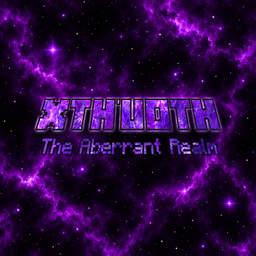

# Xth'uoth Revived



A revival of [Aurilux's Xth'uoth](https://github.com/Aurilux/Xth-uoth), a Thaumcraft addon for **Minecraft 1.7.10** with a Lovecraftian dimension, new research, and potion mixing. Install on both client and server.

> [!WARNING]
> The mod was left in a very WIP state. Its custom dimension is quite barren.

[](https://github.com/JackOfNoneTrades/Xth-uoth/releases)
[](https://67.fentanylsolutions.org/mod/xth-uoth)
[](https://maven.fentanylsolutions.org/#/releases/com/aurilux/xar/Xth-uoth)

[](https://discord.gg/xAWCqGrguG)

<!-- [](https://www.curseforge.com/minecraft/mc-mods/xth-uoth-revived) -->
<!-- [](https://modrinth.com/mod/xth-uoth-revived) -->
<!-- [](https://www.mcmod.cn/class/MY_PROJECT_ID.html) -->

## Dependencies

* [Thaumcraft 4.2.3.5](https://www.curseforge.com/minecraft/mc-mods/thaumcraft) [](https://www.curseforge.com/minecraft/mc-mods/thaumcraft)

## Building

```sh
VERSION=myversion ./gradlew build
```

## Credits

Aurilux: original mod. Glowstone Ghost: artwork. Azanor: Thaumcraft. Build based on [GT:NH Example Mod](https://github.com/GTNewHorizons/ExampleMod1.7.10).

## License

The code retains the original mod's [LGPLv3 license](LICENSE).

## Buy me some creatine

* [ko-fi.com/jackisasubtlejoke](https://ko-fi.com/jackisasubtlejoke)
* Monero: `893tQ56jWt7czBsqAGPq8J5BDnYVCg2tvKpvwTcMY1LS79iDabopdxoUzNLEZtRTH4ewAcKLJ4DM4V41fvrJGHgeKArxwmJ`


